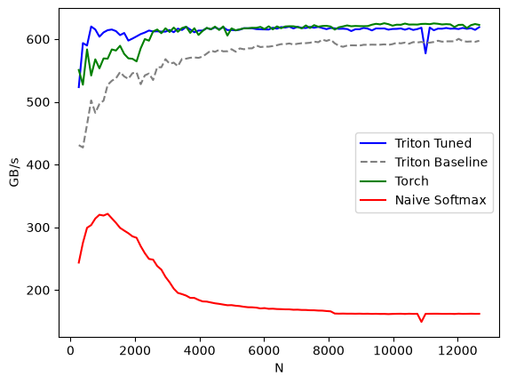

# Softmax 参数调优记录

日期：2026-10-17。设备：NVIDIA GeForce RTX 4080 SUPER，驱动 580.126.09。
环境：当前 uv 项目，PyTorch 2.8.0 CUDA 12.8、Triton 3.4.0。
性能测试范围：FP32，4096 行，列数从 256 到 12672，步长 128。
测试前 GPU 利用率为 0%，已有其他进程占用约 9.1 GiB 显存；没有停止其他进程或更改 GPU 时钟。

## 最终修改

- 原文 CUDA 包装函数保留为 `softmax_baseline`，包括固定 8 个 warp、资源估算和持久化行循环。
- `softmax` 改为每行启动一个 program，由硬件调度全部行。
- BLOCK_SIZE 不超过 2048 时使用 2 个 warp，否则使用 4 个 warp。
- 流水线阶段数设为 1。每个 program 仅处理一行，不再依赖跨行循环的流水线。
- 计算内核、用户的中文注释及 einops naive 实现保持原样。
- Notebook 的 benchmark 现在同时显示调优版、原版、PyTorch 和 naive 四条曲线。

这是一组针对本机和上述形状范围的简单实测配置，不是跨硬件自动调优器。

## 测量过程

1. 在 8 个代表尺寸上搜索 warp 数 1/2/4/8、流水线阶段数 1/2/4，以及每 SM 启动 1/2/4/8/16 个 program 或每行一个 program 的组合。每个可运行候选先与 PyTorch 检查数值，再测时；资源超限候选跳过。见 [sweep.csv](sweep.csv)。初筛使用预分配输出、已编译内核，warmup 3 ms、rep 10 ms、中位数。
2. 在 13 个尺寸上比较原版、PyTorch 和四种候选，每个尺寸重复 3 轮，打乱测量顺序。包含输出分配和实际包装函数调用；warmup 10 ms、rep 50 ms，取中位数。见 [confirm.csv](confirm.csv)。
3. 在独立 Notebook 内核中运行原有完整 benchmark，保留原来的 `triton.testing.do_bench` 默认计时方式，对比全部 98 个尺寸。见 [full-benchmark.csv](full-benchmark.csv)。
4. 对完整扫描中的异常低点及邻近尺寸，额外进行 3 轮打乱顺序的对比；warmup 25 ms、rep 100 ms，取中位数。见 [anomaly-recheck.csv](anomaly-recheck.csv)。

初筛最快的一组并不直接作为最终配置，最终选用重复测量支持的简单分段规则。

## 完整 benchmark 结果

有效带宽单位为 GB/s；三种 Softmax 和 naive 均使用输入读取一次、输出写入一次的逻辑字节数作为分子，不是硬件计数器测得的实际 DRAM 带宽。

| 列数 N | 原版 | 调优版 | PyTorch | 调优/原版 |
| ---: | ---: | ---: | ---: | ---: |
| 256 | 430.9 | 523.4 | 550.8 | 1.215× |
| 1024 | 501.9 | 610.6 | 569.2 | 1.217× |
| 2048 | 546.9 | 604.3 | 564.4 | 1.105× |
| 4096 | 572.2 | 613.6 | 613.0 | 1.072× |
| 8192 | 593.3 | 617.2 | 615.2 | 1.040× |
| 12672 | 597.3 | 619.0 | 622.6 | 1.036× |

完整单轮扫描的 98 个尺寸中，97 个更快；加速比中位数为 1.046×，几何平均为 1.072×。该统计未删除异常点。

唯一较慢点 N=11008：原版 593.9、调优版 577.2 GB/s。独立复测 3 轮后，调优版均约 616.9，原版约 594.0–595.0 GB/s，没有复现该退化。保留原始异常数据，不能据此断定异常的具体原因。

结论：参数和启动策略确实有优化空间。中小尺寸收益较明显，大尺寸收益约几个百分点，已接近 PyTorch；没有做到所有尺寸都超过 PyTorch。



## 正确性与复现

独立内核执行了 Notebook 的全部 5 个代码单元，原有 1823×781 正确性测试和完整 benchmark 均完成。
额外 53 组检查通过，涵盖 FP32/FP16/BF16、奇数列、2 的幂边界、行步长不连续但列连续，以及大幅度有限输入。误差及容差记录在 [correctness.json](correctness.json)。非 FP32 只验证正确性，未做性能调优。

在 tutorials 目录同步当前 uv 环境、选择 `.venv/bin/python`，从头运行 `02-fused-softmax.zh.ipynb` 即可重新得到四条曲线。
也可执行：

```sh
uv run --locked jupyter execute 02-fused-softmax.zh.ipynb --timeout=600 --output=/tmp/softmax-tuned.executed.ipynb
```

该实现沿用教程的输入约束：二维、列方向连续、每行适合当前内核资源；不是完整的通用 Softmax 替代品。
